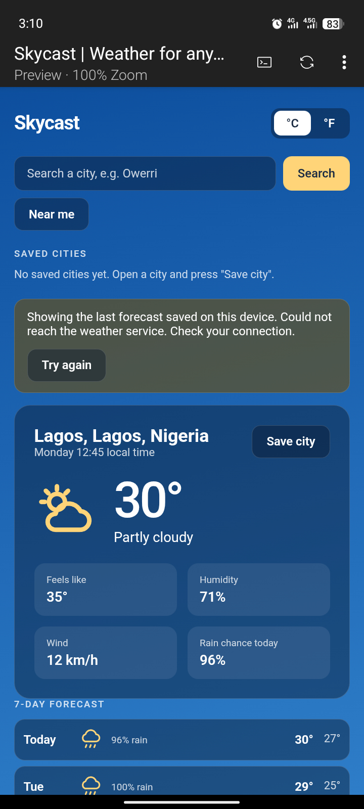

# SkyCast - Weather App

A simple, fast and responsive weather app that lets you check current weather, hourly forecast, and save your favorite cities.

**Live Demo:** https://skycast-pi-gold.vercel.app/

## Preview


### Features
- Search weather by city name
- Current temperature, condition & location
- 🔥 "Feels hot" label when temperature is above 32°C (derived state)
- Hourly forecast section (new component with props)
- Save favorite cities
- Clear all saved cities with one click
- Responsive design - works on mobile & desktop
- LocalStorage support

### Tech Stack
- React (Vite)
- CSS / Tailwind
- OpenWeatherMap API (or your weather API)
- Vercel for deployment

### Installation

1. Clone the repo:
```bash
git clone https://github.com/your-username/skycast.git
cd skycast

### Folder Structure 

src/
├── components/
│   ├── WeatherCard.jsx
│   └── HourlyForecast.jsx
├── App.jsx
├── main.jsx
└── index.css

### How it works

- Fetches current weather from weather API
- Derives `isHot` state from temperature: `temperature > 32`
- Hourly forecast data is passed as props to `HourlyForecast` component
- Saved cities are stored in localStorage

## Author
Adeola Ejikunle — [GitHub](https://github.com/DevAdeh)